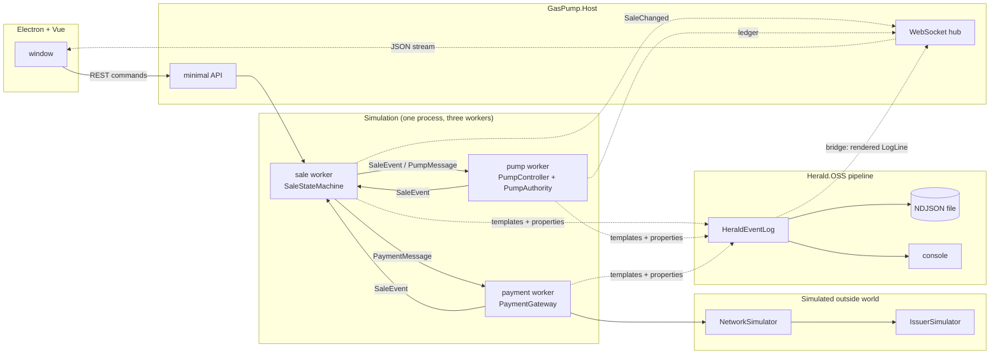
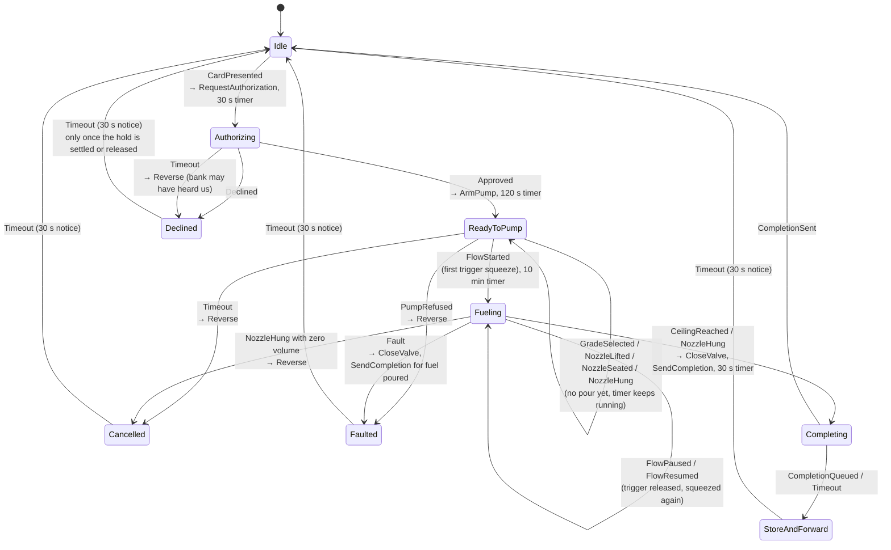
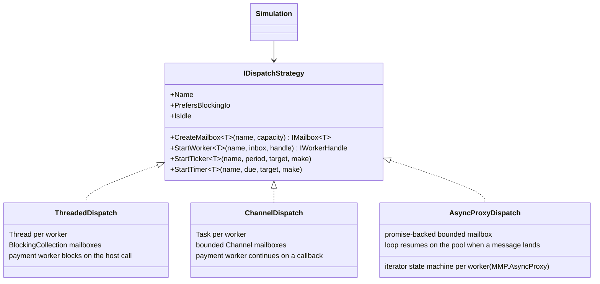
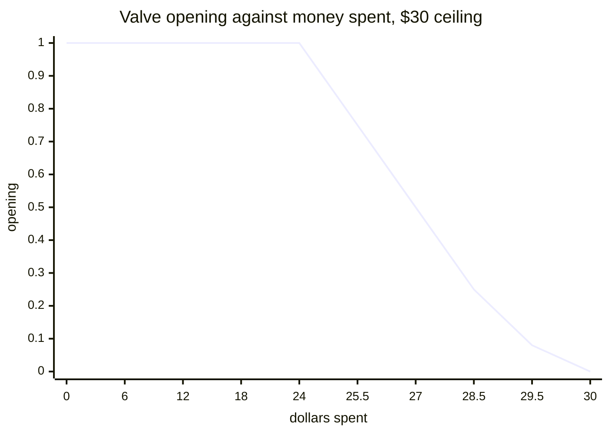
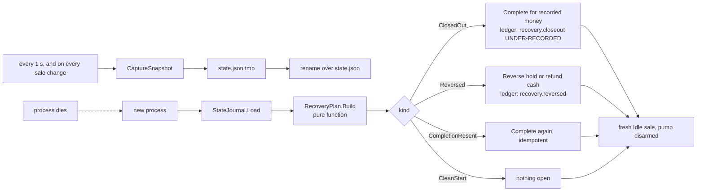

# Architecture

## Three workers, two boundaries



Every arrow between workers is a bounded mailbox. Only the sale worker changes sale state. Only the pump worker touches the valve. Only the payment worker talks to the host. The timer that drives the pump posts a `Tick` message; it never runs pump code itself.

The two trust boundaries from the research note sit here:

- **The reader protects the card.** Not modelled. `CardData` is plain because the numbers are fake.
- **The controller protects the fuel.** `PumpAuthority` in the pump worker. It verifies the token, clamps to `HardLimits`, and writes the ledger. No other code path can arm the pump.

## The sale, as a state machine



`SaleStateMachine.Apply` takes one event and returns a list of commands. It never does I/O. The simulation executes the commands by posting messages. That split is what makes the machine testable with a list and swappable under any dispatch strategy.

### The nozzle, as the driver uses it

Fuel flows only when four things are true at once, and the pump controller owns all four: the pump is armed from a verified token, a grade is selected, the nozzle is off the harness and seated in a fill point (tank or can), and the trigger is held.

1. **Lift** takes the nozzle off the harness. Nothing opens.
2. **Seat** is the fill-point sensor. Nothing opens.
3. **Squeeze** opens the valve if every interlock passes. The first squeeze is the first pour, and `Fueling` begins here, never at the lift.
4. **Release** shuts the valve. The sale stays open. Squeeze again as often as you like. The grade is locked after the first drop.
5. **Hang** after any pour ends the delivery. Hang before any pour changes nothing; the 120 s timer will cancel the sale if the driver has walked off.

### The sale as a saga

A sale is a sequence of steps across two parties who cannot see each other's state: the pump, and the bank at the far end of a network that can run late. Each step has a compensating step, and the machine tracks where the money is (`HoldStatus`) apart from where the pump is (`SaleState`).

| Step | Forward | Compensation | Who runs it |
|---|---|---|---|
| 1 | Pre-authorize a hold | Reverse the hold | Payment worker, on a `Reverse` command |
| 2 | Arm the pump from the token | Disarm, close the valve | Pump worker |
| 3 | Dispense fuel | None. Fuel does not come back. The sale settles for what moved. | |
| 4 | Complete for the real amount | Queue the completion if the bank is unreachable | Gateway store-and-forward |

Two outages that look alike from the driver's side and are handled apart:

| Link state at authorization | What the pump knows | What it does | What the screen says |
|---|---|---|---|
| Refused (`Down`) | The request never left. No hold exists. | Decline at once. No reversal, nothing queued. | "Bank link is down. Nothing was sent to your bank and nothing was charged." |
| Silent (`Timeout`, `Late`) | The bank may have heard us. | Decline at 30 s and reverse. A reversal that cannot get through is queued. | "Bank did not answer. A temporary hold may show on your card. It releases automatically." |

A link that dies **during** a sale changes nothing on the hose. The pump armed from a signed token it already holds, and it needs the bank again only at completion. Pause and resume keep working. At the hang the completion queues, the hold shows `SettlePending`, the driver is told the charge will post when the link returns and may go, and the drain settles it later. The test `Link_goes_down_mid_fuel_and_the_sale_finishes_on_the_token_then_queues_the_completion` walks that under every dispatch strategy. The pump face shows a "bank link down" chip during an outage so the operator can see it; the driver's notice does not change until completion, because nothing the driver can do changes it.

Three cases where the two parties disagree, and what the machine does:

1. **The bank answers late.** The pump gave up at 30 s and told the driver "bank did not answer". The approval lands at 45 s on a `Declined` sale. The machine never arms from it. It issues a `Reverse` and logs the late approval. If the driver has already started a new sale, the late approval is for a sale id the machine no longer holds, so the simulation sends the reversal straight to the payment worker. Either way the hold comes off.
2. **The reversal cannot reach the bank.** The gateway queues it in the same store-and-forward list as completions, once per sale, and drains it when any later call succeeds. The sale shows `ReleasePending`, and the notice tells the driver the hold releases automatically.
3. **The reversal outruns the authorization.** Both were in flight on a slow link, and the reversal arrived first. The issuer records a void for that sale id, so the late authorization is declined and never places a hold.

The driver sees all of this on the pump's screen as a `DriverNotice`: one headline, one line of detail that says where the money is, and one next step (`TryAgain`, `UseAnotherPump`, `UseAnotherCard`, `SeeAttendant`, `Leave`). A finished screen clears to `Idle` after 30 s, but only once the hold is settled or released, so a driver never walks away from a screen that still says the bank owes an answer.

## The dispatch strategy



Three rules every strategy keeps, from `IDispatchStrategy.cs`:

1. A worker handles one message at a time. Handlers never run concurrently.
2. Timers post messages. They never run code.
3. Workers share no state. They pass messages.

`PrefersBlockingIo` is the one place the strategies differ above the seam. The threaded strategy has a thread to spare, so the payment worker blocks on the host call, which is how a 2008 terminal did it. The channel and AsyncProxy strategies have no thread to spare, so the call continues on a callback and the result comes back as an event.

Under the threaded strategy that blocking shows up as head-of-line blocking: while the payment worker sits on a late bank call, the next sale's authorization waits behind it. The test `Late_approval_for_a_sale_the_driver_already_replaced_is_still_reversed` gives that case a 60 s budget for that reason; the other two strategies answer at once.

### How the AsyncProxy worker waits

```
worker loop (a C# iterator, run by AsyncProxy.Run):
    next = mailbox.DequeueAsync()        a future: complete now if an item is queued, pending otherwise
    yield return Observe(next)           the await
    handle(next.Result)                  on a pool thread, one message at a time
    repeat

mailbox.Post(item):
    a consumer is waiting  -> complete its promise with the item (continuations run on the pool)
    otherwise              -> enqueue, or wait if the box is full
```

A worker with nothing to do holds no thread, as under the channel strategy. The difference is the vocabulary: `Promise<T>`, `IFuture<T>`, and an iterator where `yield return` is `await`, all of which compile for .NET 3.5. Time still comes from the `TimeProvider`, so the same fake clock drives all three strategies in the tests.

## The taper



`TaperPolicy.Opening(remaining, ceiling)`: 1.0 until 20 percent of the ceiling is left, then `remaining / taperWindow` down to a floor of 0.08, then the controller clamps the last slice to `Pricing.MaxVolumeFor(ceiling)` and stops. The displayed money can round up to the ceiling a few pulses early, so the taper never closes the valve by itself. The volume cap does the stop.

## The token

```
saleId | pumpId | ceilingCents | maxMilliGallons | issuedAtMs | expiresAtMs | nonce | HMAC-SHA256(key, the first seven fields)
```

Verified in this order, and the order matters: format, signature, pump id, time window, nonce. A forged token fails at step two and never reaches the nonce store, so an attacker cannot burn nonces with garbage.

## The ledger

Each entry: `seq | at | kind | detail | prevHash | hash` where `hash = SHA-256(seq|at|kind|detail|prevHash)`. `Verify` walks the chain and returns the first broken sequence number or 0. The totalizer's running total is written on every valve close, so the books can be checked against the meter even if sale records were erased.

## Three ceilings, in order

A sale's ceiling passes three gates, and each one can only lower it.

| Gate | Owner | Credit | Debit | Cash |
|---|---|---|---|---|
| 1. Site ceiling | `SiteLimits`, set from the admin panel behind a PIN | $75 default | $50 default | none: the cash amount is the ceiling |
| 2. Bank's answer | `IssuerSimulator` | approved amount, may be partial | approved amount, may be partial | no bank call |
| 3. Hard limit | `HardLimits` in the pump, fixed at construction | $500, 50 gal | $500, 50 gal | $500, 50 gal |

The pump's ceiling is the lesser of gates 1 and 2, then clamped by gate 3. The admin panel can move gate 1 anywhere; it can never move gate 3. That is why the admin panel is on the attack surface: owning it buys an attacker nothing past $500.

Cash settles at the till (`CashDrawer`): the driver prepays, the pump stops on that amount to the cent, and whatever was not pumped comes back as change. A cash sale abandoned before any pour refunds in full. No network, so a dead bank link never touches a cash sale.

## Delivery stages and the price schedule

Two seams in the pump controller for parts that are not here yet, added 2026-11-01 so an additive injector, a vapor-recovery monitor, or a blend check can bolt on without the controller changing.

| Seam | Type | What it replaces | How a new part uses it |
|---|---|---|---|
| Price schedule | `IPriceSchedule` (Core) | The controller took the concrete `Pricing` record | A schedule that wraps the price board, for a surcharge or a discount. `MaxVolumeFor` must agree with `CentsFor`, so the sale still lands on the cent. |
| Delivery stage | `IDeliveryStage` (Pump) | Nothing; the tick had no hook after the totalizer | `OnArmed` per sale, `OnDelivered` per metered slice after the totalizer counted it, `Conditions()` to hold the pump out of service with its own diagnostic code, `TryRestoreCondition` so a restart repairs nothing. |

`Dispenser` takes both as optional constructor arguments. Nothing is built on them yet. Three tests in `PumpTests.cs` prove the contract: a stage sees every slice and their sum is the sale volume; a broken stage refuses the arm with its code in the ledger and clears when fixed; a wrapped schedule bills more and the sale still stops under the ceiling.

## Charge lines

The money is itemized from the pump outward. `IPriceSchedule.Lines(grade, volume)` returns the `ChargeLine`s (code, description, amount) whose sum is `CentsFor`; the board answers with one `FUEL` line, a wrapping schedule appends its own. The controller sets `Lines` beside `Money` on every tick; `Progress` and `CeilingReached` carry them to the station; the sale machine keeps the last breakdown and puts it on `SendCompletion`, `PendingAdvice`, `PaymentMessage.Complete`, and the journal (`JournalLine`), so a completion resent after a restart carries the same lines. `IIssuer.Complete(saleId, final, lines)` records a `Settlement` at the bank. `SaleSnapshot.Charges` is what a receipt prints; it is empty before fuel moves and reads the same lines the bank received. A sale whose pump sent no breakdown gets one fuel line for its money.

## Capabilities

`Simulation.Capabilities` is a `CapabilityHost`. An `IStationCapability` receives every `SaleEvent` the sale worker applied and every `DispenserView` the dispenser sent, on its own worker behind its own bounded mailbox (256). It has no way to post back. A full mailbox drops and counts; a capability that throws is switched off for the run and logged under `capability`; the sale never waits on one and never hears from one. Register before the first sale. A video that plays on `FlowStarted`, a loyalty prompt, and a forecourt display are the intended users. Proof: `SimulationTests`, a recorder sees one `FlowStarted` per sale while a capability that throws on it is switched off and the sale settles to the cent.

## Logging on Herald.OSS

`HeraldEventLog` in `GasPump.Dispatch` implements the simulator's `IEventLog` over a Herald.OSS `QuickLogBuilder` pipeline. Each worker's source (sale, pump, payment, admin, attack, network, host) is a Herald category. Workers write templates with properties; Herald renders the message and keeps the properties. Three sinks:

1. A bridge sink back into the simulation. It hands every rendered event to the UI stream and to the tests as a `LogLine`, so what the UI shows is what Herald wrote. The line is stamped from the simulation's own clock, so tests on a fake clock read simulated time.
2. A console sink in the host.
3. An NDJSON file sink in the host, one file per session, under `%LOCALAPPDATA%\MMP.GasPumpSimulator\logs` (or `GASPUMP_LOG_DIR`). Properties survive, so a session can be queried later.

The plain `EventLog` in `GasPump.Core` stays as a dependency-free fallback that renders the same templates itself; `Simulation` takes any `IEventLog`.

## Power loss: the journal and the close-out

A pump that loses power mid-sale has one job when it comes back: close the sale for what it knows, say how much it does not know, and be ready for the next driver. It never resumes. A resumed sale would need the nozzle still seated, the token still valid, and the meter trusted across the gap, and none of those hold after a reboot.



What the snapshot holds: the sale (id, state, tender, grade, ceiling, volume, money, flow, hold, cash prepaid), the pump phase, the store-and-forward queue and the tender per sale, the till, the site limits with the PIN failure count and lockout, the sealed totalizer, every burned nonce, the sale counter, and the in-process bank's accounts and holds. The bank is journaled because this simulator's bank lives in the pump's process; a real bank keeps its own books.

What the restart does with it, in order: restore every store, build the plan, start the workers, write `recovery.restart` to the ledger, then carry the plan out through the payment worker as an ordinary `Complete` or `Reverse`. The pump itself needs nothing: a new process has no armed authorization, so the valve is shut by construction.

Why the grade is in the journal: the close-out prices the recorded volume at the grade's price per gallon. It is never used to re-arm.

The number it reports. The last snapshot is at most one period old, and fuel may have flowed until the process died, so the close-out records the metered volume and states an upper bound for what it missed: one period at the last flow rate. `recovery.closeout` carries the phrase `DELIVERY LIKELY UNDER-RECORDED`, the log line is at Error level, and the custody file has both. Nothing invents a number the meter did not count.

The token key survives the reboot. With a journal configured, the pump's token key is derived from the custody key under its own label, so a token issued before the reboot fails after it on its nonce (`Replayed`), not on its signature. A random key per process would make a replay look like a forgery and hide the replay. The test `Replayed_token_is_still_refused_after_a_restart` pins this.

## Who owns what

Three beliefs set the boundaries, and the three workers already sit on them:

| Belief | Worker today | What it owns | Boundary |
|---|---|---|---|
| The pump pumps according to its authorized limits | pump worker (`PumpController`, `PumpAuthority`) | the valve, the meter, the hard limits, the nozzle interlocks, every diagnostic code about a wet part | a mailbox in one process today; a network hop later, with the same message types |
| Telemetry is stored on the dispenser and sent to the station | the TesseraSeal sink plus `CustodyStream` | the custody file, and the byte-identical stream of its lines | the stream is the wire: `StationServer` in-process, `/ws/custody` for anything outside |
| The station opens and closes the transaction session | sale worker (`SaleStateMachine`) and payment worker (`PaymentGateway`) | the sale saga, the tender, the money, the notice | the same mailbox seam |

What moves across the first seam is only messages: `PumpMessage` down, `SaleEvent` up. Nothing in the sale worker reads pump state, and nothing in the pump worker reads sale state. Since slice 2e that seam is a socket by default.

## Two processes

```
GasPump.Host.exe  (the station)                     GasPump.Dispenser.exe  (the island)
  sale worker, payment worker                         pump worker, ticker
  SaleStateMachine, PaymentGateway, Issuer            PumpController, Hydraulics, Meter
  SiteLimits, CashDrawer, journal (state.json)        PumpAuthority, NonceStore, Totalizer
  station ledger, station chain                       dispenser ledger, dispenser chain
  StationServer: copy of the dispenser chain          dispenser-state.json (totalizer, nonces)
  SocketDispenserLink  <==== TCP 127.0.0.1:5178 ====>  DispenserServer
       msg {saleId, PumpMessage}  ---->
       power off                  ---->
                                  <----  event {SaleEvent}, view, log, ledger, custody line
```

One JSON object per line. `PumpMessage` and `SaleEvent` carry a type discriminator, so the records that were the contract between two mailboxes are the contract between two processes with no translation. The tick never crosses the wire; the dispenser has its own.

| Belief | Where it shows |
|---|---|
| The pump pumps under its authorized limits | The hard limits, the authority, and the nonce store live in the dispenser process. A station that signs for 600 gallons gets clamped by a process it cannot reach into. |
| Custody is stored on the dispenser and sent to the station | The dispenser writes `dispenser-custody-<run>.ndjson` and streams each line as it lands. The station appends the same bytes to `station-copy-<run>.ndjson` and verifies the copy with the same key. |
| The station owns session open and close | `sale.open` and `sale.close` are station ledger entries. The journal is the station's. Recovery is the station's. The dispenser never knows what a sale is; it knows a token, a valve, and a counter. |

Each side is safe alone. Dispenser gone: the station faults the sale with `LINK.DISPENSER.LOST`, settles for the fuel it recorded, and refuses to pretend the pump is there. Station gone with the valve open: the dispenser keeps pouring under its own ceiling and time limit, and the first frame the new station sends is `Stop`. E-stop: the station writes its record and snapshot, sends `power off`, and the dispenser process closes its chain and exits; the cashier's reset starts it again before the new station connects.

`--dispenser inproc` keeps both sides in one process behind the same `IDispenserLink` interface, which is how the 191 fake-clock tests run. The three socket tests run on a real clock over loopback.

The UI is two columns and a strip. Amber, left: the pump face, the hand controls, the forecourt faults, and the dispenser's own log, ledger, and chain. Blue, right: payment, bank link, administrator, E-stop, journal, and the station's own records plus its copy of the dispenser chain. The strip between them is the wire: the port, the frame counters both ways, the chain lines received. Every record carries its origin, and over the socket that origin is a fact of which process sent it.

## Forecourt faults and the E-stop

Every failed part raises a diagnostic code from `docs/diagnostics.md`, and the controller learns about it from a disagreement between two facts it already has:

| Disagreement | Code | Window |
|---|---|---|
| Valve commanded open, flow switch says nothing moved | `PUMP.STP.NOFLOW` | 3 s |
| Flow switch says fuel moved, pulser sent nothing | `PUMP.MTR.NOPULSE` | 300 ms |
| Pulser sent more than the valve could pass | `PUMP.MTR.OVERPULSE` | one tick |
| Pulses with the valve shut | `PUMP.MTR.STRAY` | one tick |
| Breakaway sensor open | `PUMP.HOSE.BREAKAWAY` | at once |

The tank gauge's Fuel Out alarm reaches the pump as the first row; the gauge entry `TANK.FUELOUT` is in the ledger beside it, so the record shows cause and effect.

The E-stop is the odd one out: it is not a message the pump handles, it is the power leaving. The order of operations is the whole design. The site controller, outside the classified area and still powered, writes `station.estop` to the ledger and the custody file, saves one last snapshot with `StopReason = "ESTOP"`, and only then drops the pump. The cashier's reset builds a new Simulation on that snapshot, and because the snapshot was taken after the last tick, the recovery reports nothing unrecorded. A bare power loss cannot do any of that, which is why the recovery note for it says "likely under-recorded" and the note for an E-stop does not.

### Service conditions

A fault that needs a repair is a service condition. The condition holds the pump out of service until the repair, and both sides of the seam react to the repair through one event.

| Step | Where | What happens |
|---|---|---|
| 1 | Dispenser | `PumpController.Service` reads the conditions from the sensors: breakaway separated, supply off, pulser dead. Nothing is stored, so a fixed part cannot still read as broken. |
| 2 | Dispenser | `Arm` is refused while any condition holds. After every non-tick message, a pump `Faulted` for an out-of-service code goes back to `Disarmed` when no condition holds it. |
| 3 | Seam | `DispenserView.Service` carries the codes. The offline view carries `LINK.DISPENSER.LOST`, so link loss and link return travel the same path as a broken or fixed part. |
| 4 | Station | `Simulation` compares each view's status with the last one, and on a change posts `SaleEvent.PumpService` and appends `service.status` to the ledger. That is the only emitter. `BeginSale` refuses every payment while the status is not in service, and each new sale starts from the last status. |
| 5 | Sale machine | Before the first pour, an out-of-service report faults the sale, closes the valve, and reverses the hold. A sale faulted for an out-of-service code clears to `Idle` when the code goes away and the hold is settled. The settled-hold check is the same one the notice timeout uses. |

The sale machine never reads a pump object and the pump never reads a sale. Which codes need a repair, and which repair, is one column on the diagnostic table: `DiagnosticCode.ClearedBy`. `docs/diagnostics.md` states the rule.

## The compensation log

Every step toward "fuel for money" has a step back: a hold is reversed, a completion is sent. The gateway's pending queue is where those steps wait for the bank, and since decision 55 it is write-ahead. The sale worker records the intent on its own thread, in `Simulation.Execute`, before it posts the message to the payment worker; the station journals the queue the moment it changes; the payment worker's only job is to drain the queue, oldest first, and remove each advice when the bank has it. A crash anywhere in between leaves the intent on disk, and the next start drains it. The issuer's complete and reverse are idempotent, so a repeated advice is free.

## Two files: debug log and custody file

| | Herald.OSS NDJSON | TesseraSeal custody file |
|---|---|---|
| Writer | Herald file sink | `ImmutableAuditFileSink` from Herald.Compliance, compiled in by source link |
| Gets | every event from every worker | categories `ledger`, `sale`, `payment`, `admin`, `recovery`, `attack` |
| Shape | one JSON object per line | header line, then one JCS-canonical event per line with an `audit_chain` block: `seq`, `prev_hash`, `payload_hash` (HMAC-SHA-256 under an HKDF session key), `key_version`, `key_fingerprint`, `format_version` |
| Lifetime | one file per host session | one chain per run; a restart opens a new chain with a zero genesis, as the spec requires |
| Check | read it | TesseraSeal's verifier: header, format, genesis, tenant, then per entry the binding, the sequence, the previous hash, the key fingerprint, and the MAC, in that order, with the spec's reason strings |
| Reads live | yes | from a copy taken under shared access, because the sink holds the file open for append |

Both sinks hang off the same Herald pipeline. The simulator writes one structured event; Herald fans it to the UI bridge, the debug file, and the custody bridge, so the three can never disagree about what happened.

Out of scope here and stated as such: the daily Merkle seal and the HSM signature (primitives 2 and 3 of the spec). A one-pump simulator has primitive 1, the per-event HMAC chain, and the software key file stands in for the custodian.

## Timers, and what each one protects

| Timer | Default | Fires when | Then |
|---|---|---|---|
| Authorization | 30 s | The bank has not answered | Decline, reverse, tell the driver to try again or use another pump |
| Nozzle lift | 120 s | Approved, but no pour has started | Cancel, reverse, screen says the sale was cancelled |
| Max fueling | 10 min | Fueling, including pauses | Close the valve, settle for what moved |
| Completion | 30 s | The completion has not been acknowledged | Store-and-forward, driver may leave |
| Notice | 30 s | A finished screen has been shown | Clear to Idle, unless the hold is still unsettled, then wait another 30 s |
| Hard duration | 10 min | Owned by the pump, checked every tick | Stop, whatever the sale machine thinks |

The driver sees the live countdown on the pump face. The simulation stamps `DeadlineAt` on every snapshot when a timer is armed.

## Timing

Every component takes a `TimeProvider`. The tests use `FakeTimeProvider` and a harness that advances the clock in tick-sized steps, waiting for the workers to go quiet between steps. A full $30 sale, 90 seconds of simulated time, runs in under a second of real time. The host uses `TimeProvider.System`.
