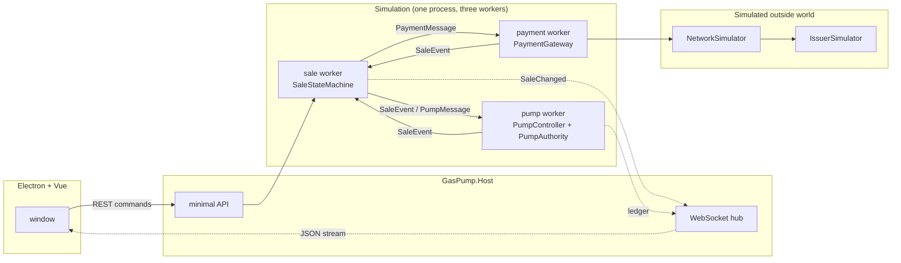
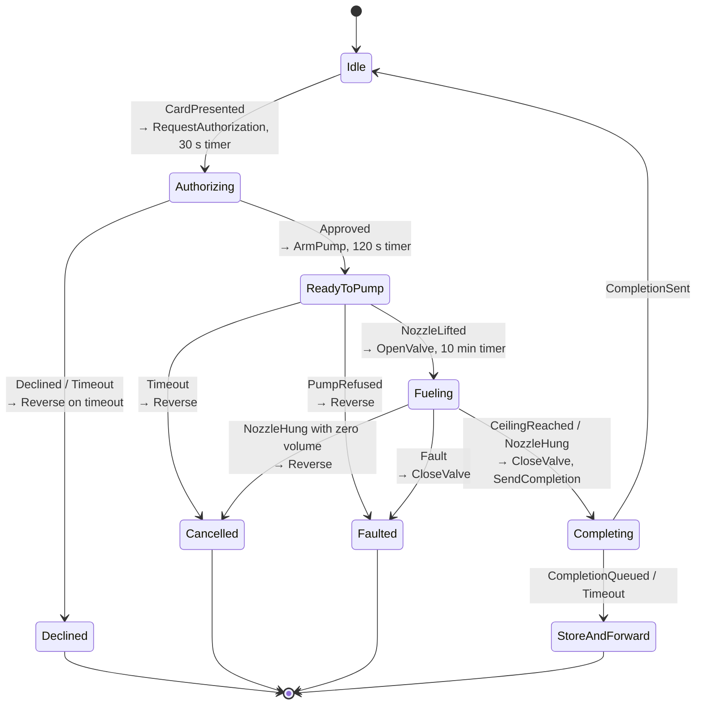
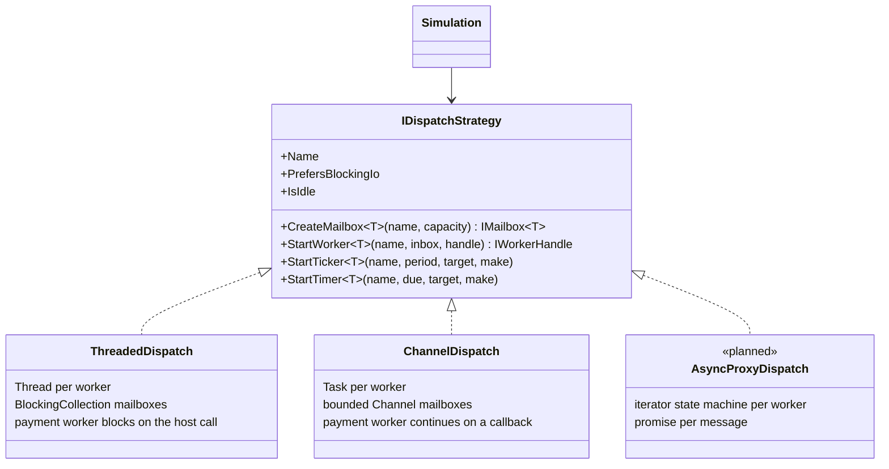
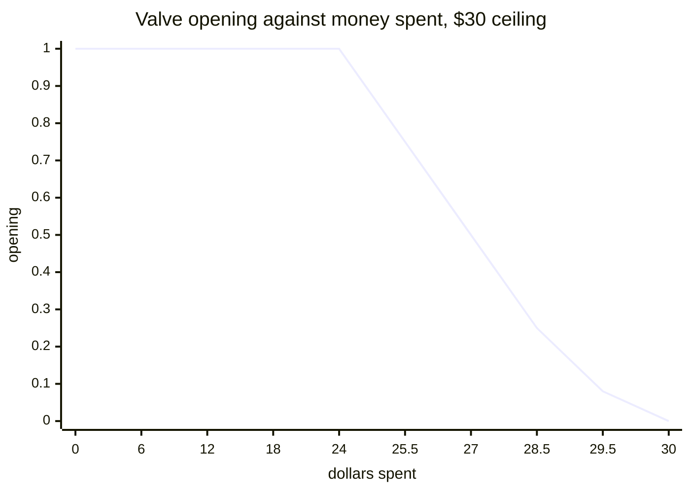

# Architecture

## Three workers, two boundaries



Every arrow between workers is a bounded mailbox. Only the sale worker changes sale state. Only the pump worker touches the valve. Only the payment worker talks to the host. The timer that drives the pump posts a `Tick` message; it never runs pump code itself.

The two trust boundaries from the research note sit here:

- **The reader protects the card.** Not modelled. `CardData` is plain because the numbers are fake.
- **The controller protects the fuel.** `PumpAuthority` in the pump worker. It verifies the token, clamps to `HardLimits`, and writes the ledger. No other code path can arm the pump.

## The sale, as a state machine



`SaleStateMachine.Apply` takes one event and returns a list of commands. It never does I/O. The simulation executes the commands by posting messages. That split is what makes the machine testable with a list and swappable under any dispatch strategy.

## The dispatch strategy



Three rules every strategy keeps, from `IDispatchStrategy.cs`:

1. A worker handles one message at a time. Handlers never run concurrently.
2. Timers post messages. They never run code.
3. Workers share no state. They pass messages.

`PrefersBlockingIo` is the one place the strategies differ above the seam. The threaded strategy has a thread to spare, so the payment worker blocks on the host call, which is how a 2008 terminal did it. The channel strategy has no thread to spare, so the call continues on a callback and the result comes back as an event.

## The taper



`TaperPolicy.Opening(remaining, ceiling)`: 1.0 until 20 percent of the ceiling is left, then `remaining / taperWindow` down to a floor of 0.08, then the controller clamps the last slice to `Pricing.MaxVolumeFor(ceiling)` and stops. The displayed money can round up to the ceiling a few pulses early, so the taper never closes the valve by itself. The volume cap does the stop.

## The token

```
saleId | pumpId | ceilingCents | maxMilliGallons | issuedAtMs | expiresAtMs | nonce | HMAC-SHA256(key, the first seven fields)
```

Verified in this order, and the order matters: format, signature, pump id, time window, nonce. A forged token fails at step two and never reaches the nonce store, so an attacker cannot burn nonces with garbage.

## The ledger

Each entry: `seq | at | kind | detail | prevHash | hash` where `hash = SHA-256(seq|at|kind|detail|prevHash)`. `Verify` walks the chain and returns the first broken sequence number or 0. The totalizer's running total is written on every valve close, so the books can be checked against the meter even if sale records were erased.

## Timing

Every component takes a `TimeProvider`. The tests use `FakeTimeProvider` and a harness that advances the clock in tick-sized steps, waiting for the workers to go quiet between steps. A full $30 sale, 90 seconds of simulated time, runs in under a second of real time. The host uses `TimeProvider.System`.
