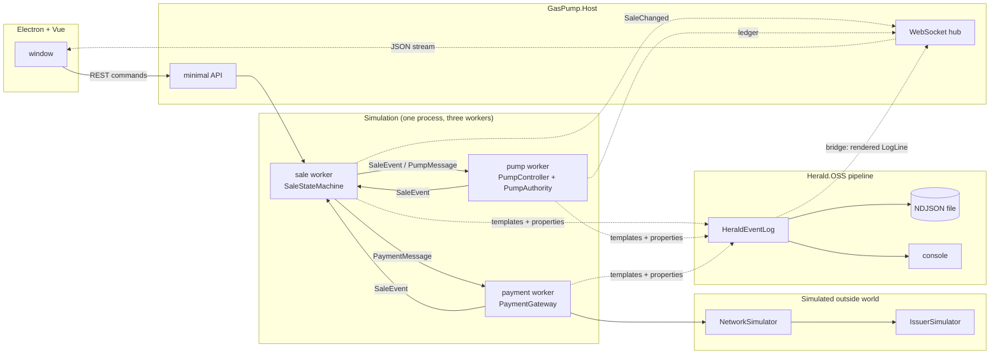
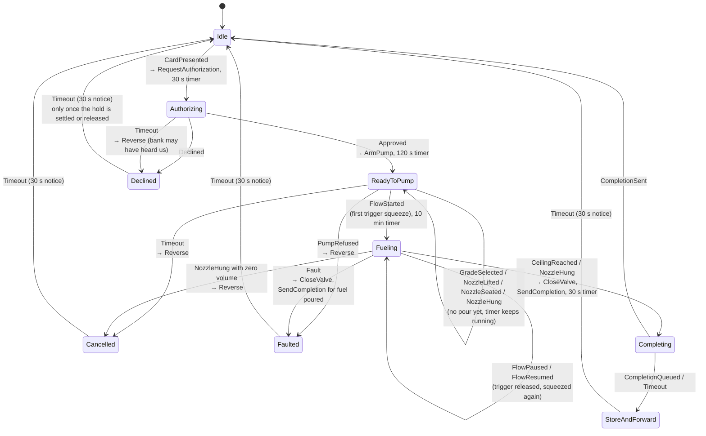
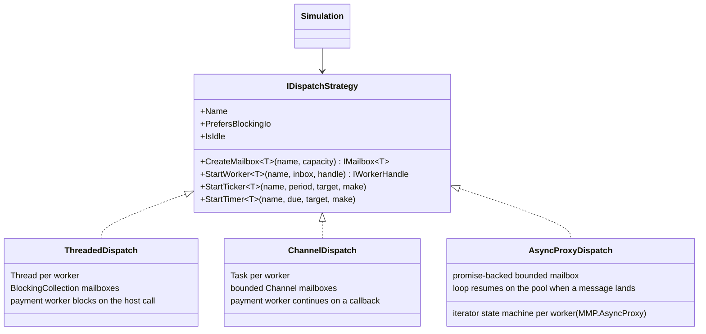
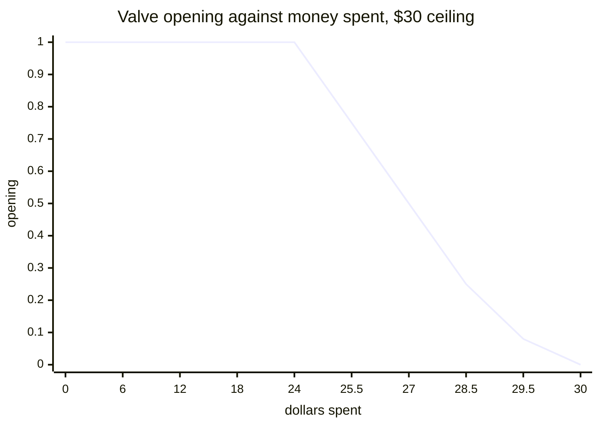

# Architecture

## Three workers, two boundaries



Every arrow between workers is a bounded mailbox. Only the sale worker changes sale state. Only the pump worker touches the valve. Only the payment worker talks to the host. The timer that drives the pump posts a `Tick` message; it never runs pump code itself.

The two trust boundaries from the research note sit here:

- **The reader protects the card.** Not modelled. `CardData` is plain because the numbers are fake.
- **The controller protects the fuel.** `PumpAuthority` in the pump worker. It verifies the token, clamps to `HardLimits`, and writes the ledger. No other code path can arm the pump.

## The sale, as a state machine



`SaleStateMachine.Apply` takes one event and returns a list of commands. It never does I/O. The simulation executes the commands by posting messages. That split is what makes the machine testable with a list and swappable under any dispatch strategy.

### The nozzle, as the driver uses it

Fuel flows only when four things are true at once, and the pump controller owns all four: the pump is armed from a verified token, a grade is selected, the nozzle is off the harness and seated in a fill point (tank or can), and the trigger is held.

1. **Lift** takes the nozzle off the harness. Nothing opens.
2. **Seat** is the fill-point sensor. Nothing opens.
3. **Squeeze** opens the valve if every interlock passes. The first squeeze is the first pour, and `Fueling` begins here, never at the lift.
4. **Release** shuts the valve. The sale stays open. Squeeze again as often as you like. The grade is locked after the first drop.
5. **Hang** after any pour ends the delivery. Hang before any pour changes nothing; the 120 s timer will cancel the sale if the driver has walked off.

### The sale as a saga

A sale is a sequence of steps across two parties who cannot see each other's state: the pump, and the bank at the far end of a network that can run late. Each step has a compensating step, and the machine tracks where the money is (`HoldStatus`) apart from where the pump is (`SaleState`).

| Step | Forward | Compensation | Who runs it |
|---|---|---|---|
| 1 | Pre-authorize a hold | Reverse the hold | Payment worker, on a `Reverse` command |
| 2 | Arm the pump from the token | Disarm, close the valve | Pump worker |
| 3 | Dispense fuel | None. Fuel does not come back. The sale settles for what moved. | |
| 4 | Complete for the real amount | Queue the completion if the bank is unreachable | Gateway store-and-forward |

Three cases where the two parties disagree, and what the machine does:

1. **The bank answers late.** The pump gave up at 30 s and told the driver "bank did not answer". The approval lands at 45 s on a `Declined` sale. The machine never arms from it. It issues a `Reverse` and logs the late approval. If the driver has already started a new sale, the late approval is for a sale id the machine no longer holds, so the simulation sends the reversal straight to the payment worker. Either way the hold comes off.
2. **The reversal cannot reach the bank.** The gateway queues it in the same store-and-forward list as completions, once per sale, and drains it when any later call succeeds. The sale shows `ReleasePending`, and the notice tells the driver the hold releases automatically.
3. **The reversal outruns the authorization.** Both were in flight on a slow link, and the reversal arrived first. The issuer records a void for that sale id, so the late authorization is declined and never places a hold.

The driver sees all of this on the pump's screen as a `DriverNotice`: one headline, one line of detail that says where the money is, and one next step (`TryAgain`, `UseAnotherPump`, `UseAnotherCard`, `SeeAttendant`, `Leave`). A finished screen clears to `Idle` after 30 s, but only once the hold is settled or released, so a driver never walks away from a screen that still says the bank owes an answer.

## The dispatch strategy



Three rules every strategy keeps, from `IDispatchStrategy.cs`:

1. A worker handles one message at a time. Handlers never run concurrently.
2. Timers post messages. They never run code.
3. Workers share no state. They pass messages.

`PrefersBlockingIo` is the one place the strategies differ above the seam. The threaded strategy has a thread to spare, so the payment worker blocks on the host call, which is how a 2008 terminal did it. The channel and AsyncProxy strategies have no thread to spare, so the call continues on a callback and the result comes back as an event.

Under the threaded strategy that blocking shows up as head-of-line blocking: while the payment worker sits on a late bank call, the next sale's authorization waits behind it. The test `Late_approval_for_a_sale_the_driver_already_replaced_is_still_reversed` gives that case a 60 s budget for that reason; the other two strategies answer at once.

### How the AsyncProxy worker waits

```
worker loop (a C# iterator, run by AsyncProxy.Run):
    next = mailbox.DequeueAsync()        a future: complete now if an item is queued, pending otherwise
    yield return Observe(next)           the await
    handle(next.Result)                  on a pool thread, one message at a time
    repeat

mailbox.Post(item):
    a consumer is waiting  -> complete its promise with the item (continuations run on the pool)
    otherwise              -> enqueue, or wait if the box is full
```

A worker with nothing to do holds no thread, as under the channel strategy. The difference is the vocabulary: `Promise<T>`, `IFuture<T>`, and an iterator where `yield return` is `await`, all of which compile for .NET 3.5. Time still comes from the `TimeProvider`, so the same fake clock drives all three strategies in the tests.

## The taper



`TaperPolicy.Opening(remaining, ceiling)`: 1.0 until 20 percent of the ceiling is left, then `remaining / taperWindow` down to a floor of 0.08, then the controller clamps the last slice to `Pricing.MaxVolumeFor(ceiling)` and stops. The displayed money can round up to the ceiling a few pulses early, so the taper never closes the valve by itself. The volume cap does the stop.

## The token

```
saleId | pumpId | ceilingCents | maxMilliGallons | issuedAtMs | expiresAtMs | nonce | HMAC-SHA256(key, the first seven fields)
```

Verified in this order, and the order matters: format, signature, pump id, time window, nonce. A forged token fails at step two and never reaches the nonce store, so an attacker cannot burn nonces with garbage.

## The ledger

Each entry: `seq | at | kind | detail | prevHash | hash` where `hash = SHA-256(seq|at|kind|detail|prevHash)`. `Verify` walks the chain and returns the first broken sequence number or 0. The totalizer's running total is written on every valve close, so the books can be checked against the meter even if sale records were erased.

## Three ceilings, in order

A sale's ceiling passes three gates, and each one can only lower it.

| Gate | Owner | Credit | Debit | Cash |
|---|---|---|---|---|
| 1. Site ceiling | `SiteLimits`, set from the admin panel behind a PIN | $75 default | $50 default | none: the cash amount is the ceiling |
| 2. Bank's answer | `IssuerSimulator` | approved amount, may be partial | approved amount, may be partial | no bank call |
| 3. Hard limit | `HardLimits` in the pump, fixed at construction | $500, 50 gal | $500, 50 gal | $500, 50 gal |

The pump's ceiling is the lesser of gates 1 and 2, then clamped by gate 3. The admin panel can move gate 1 anywhere; it can never move gate 3. That is why the admin panel is on the attack surface: owning it buys an attacker nothing past $500.

Cash settles at the till (`CashDrawer`): the driver prepays, the pump stops on that amount to the cent, and whatever was not pumped comes back as change. A cash sale abandoned before any pour refunds in full. No network, so a dead bank link never touches a cash sale.

## Logging on Herald.OSS

`HeraldEventLog` in `GasPump.Dispatch` implements the simulator's `IEventLog` over a Herald.OSS `QuickLogBuilder` pipeline. Each worker's source (sale, pump, payment, admin, attack, network, host) is a Herald category. Workers write templates with properties; Herald renders the message and keeps the properties. Three sinks:

1. A bridge sink back into the simulation. It hands every rendered event to the UI stream and to the tests as a `LogLine`, so what the UI shows is what Herald wrote. The line is stamped from the simulation's own clock, so tests on a fake clock read simulated time.
2. A console sink in the host.
3. An NDJSON file sink in the host, one file per session, under `%LOCALAPPDATA%\MMP.GasPumpSimulator\logs` (or `GASPUMP_LOG_DIR`). Properties survive, so a session can be queried later.

The plain `EventLog` in `GasPump.Core` stays as a dependency-free fallback that renders the same templates itself; `Simulation` takes any `IEventLog`.

## Timers, and what each one protects

| Timer | Default | Fires when | Then |
|---|---|---|---|
| Authorization | 30 s | The bank has not answered | Decline, reverse, tell the driver to try again or use another pump |
| Nozzle lift | 120 s | Approved, but no pour has started | Cancel, reverse, screen says the sale was cancelled |
| Max fueling | 10 min | Fueling, including pauses | Close the valve, settle for what moved |
| Completion | 30 s | The completion has not been acknowledged | Store-and-forward, driver may leave |
| Notice | 30 s | A finished screen has been shown | Clear to Idle, unless the hold is still unsettled, then wait another 30 s |
| Hard duration | 10 min | Owned by the pump, checked every tick | Stop, whatever the sale machine thinks |

The driver sees the live countdown on the pump face. The simulation stamps `DeadlineAt` on every snapshot when a timer is armed.

## Timing

Every component takes a `TimeProvider`. The tests use `FakeTimeProvider` and a harness that advances the clock in tick-sized steps, waiting for the workers to go quiet between steps. A full $30 sale, 90 seconds of simulated time, runs in under a second of real time. The host uses `TimeProvider.System`.
