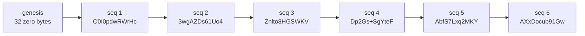

# The chain of custody, entry by entry

The custody file catches an edit, an inserted entry, a deleted entry, a reordered entry, and an entry from another chain. The Go reference verifier names the entry and the step for each one. Three attacks still pass, because the simulator writes no daily seal. This article shows all of it, with output you can reproduce.

| Check | Result |
|---|---|
| Sample file, 36 entries, full key check | `Status: PASS` |
| Attacks caught | 13 of 16, each at a named step |
| Attacks that pass | 3 of 16, listed under [What still passes](#what-still-passes) |

Two languages agree on this file. A .NET sink wrote the events, and a Go verifier that shares no code with it checks them.

## The file

[`docs/samples/custody-chain-sample.ndjson`](../samples/custody-chain-sample.ndjson) is one dispenser's run at the Samms station: pump PUMP-01, two sales, and one pulse-spoofing attack. Line 1 is a header. Each later line is one event with its stamp.

The sample differs from the original run in two ways, and [`make_sample.py`](../../tools/custody-walk/make_sample.py) does both:

1. A local log path in entry 2 became `C:\GasPumpDemo\logs\`.
2. Every entry was sealed again under a demo key, because the path sits inside the sealed bytes. The key is published at [`custody-chain-sample.key.hex`](../samples/custody-chain-sample.key.hex), so that you can run the full check. It protects nothing.

The events, their order, and their times are as the run wrote them.

## One entry

This is entry 6, indented for reading. The pump armed for a $30.00 sale.

```json
{
  "audit_chain": {
    "format_version": "v1",
    "key_fingerprint": "0HhGSX589rEbVHpRXeiqYA==",
    "key_version": 1,
    "kms_handle_uri": "plaintext-dev",
    "mac_computed_at_utc": "2026-11-04T02:31:00.3540027+00:00",
    "payload_hash": "AXxDocub91GwmDTPhmJMQA1qwLa5D0JA7NUo0FaiuGo=",
    "prev_hash": "AbfS7Lxq2MKYVdpcBEg9zr+48CAbqJDUR9gDxw8iQGU=",
    "seq": 6
  },
  "category": "ledger",
  "level": "information",
  "message": "#2 arm.ok P1-S0003 ceiling $30.00 max 50.000 gal within limits",
  "run_id": "DSP-20261104-023039-baa0fe",
  "tenant_id": "PUMP-01",
  "time_utc": "2026-11-04T02:31:00.3535010+00:00"
}
```

The file holds more fields than this view shows, such as `properties`. The `audit_chain` block is the stamp. Everything else is the event.

| Stamp field | What it does |
|---|---|
| `seq` | Counts up from 1 in each run. |
| `prev_hash` | Holds the `payload_hash` of the entry before. Entry 1 holds 32 zero bytes. |
| `payload_hash` | The MAC (a keyed checksum) over `prev_hash` and the event. |
| `key_fingerprint` | Identifies the key without showing it. |
| `kms_handle_uri` | Says where the key lives. `plaintext-dev` means a development key in a file. |

## The first six entries

Each entry's `prev_hash` is the `payload_hash` of the entry before it. The hashes below are shortened to 12 characters.

| seq | Event | `prev_hash` | `payload_hash` |
|---|---|---|---|
| 1 | Prices read from the state file | `AAAAAAAAAAAA` | `O0I0pdwRWrHc` |
| 2 | Dispenser listening on port 5278 | `O0I0pdwRWrHc` | `3wgAZDs61Uo4` |
| 3 | Ledger #1: `dispenser.start` | `3wgAZDs61Uo4` | `Znlto8HGSWKV` |
| 4 | Station connected | `Znlto8HGSWKV` | `Dp2Gs+SgYteF` |
| 5 | Station said hello | `Dp2Gs+SgYteF` | `AbfS7Lxq2MKY` |
| 6 | Ledger #2: `arm.ok`, ceiling $30.00 | `AbfS7Lxq2MKY` | `AXxDocub91Gw` |



### How one link is computed

These lines come from §4.1 of the spec:

```
info_for_tenant = "ffiec.chain-of-custody.v1.info" || "|" || tenant_id
session_key     = HKDF-SHA-256(ikm, salt="ffiec.chain-of-custody.v1.salt", info_for_tenant, 32 bytes)
canonical       = RFC 8785 JSON of the event, without the audit_chain block
payload_hash    = HMAC-SHA-256(session_key, prev_hash || canonical)
```

[`explain.py`](../../tools/custody-walk/explain.py) recomputes this with the Python standard library, and shares no code with the sink or the verifier:

```
$ python tools/custody-walk/explain.py docs/samples/custody-chain-sample.ndjson docs/samples/custody-chain-sample.key.hex
session key fingerprint: 0HhGSX589rEbVHpRXeiqYA==
seq 1: prev AAAAAAAAAAAA...  computed O0I0pdwRWrHc...  stored O0I0pdwRWrHc...  match
seq 2: prev O0I0pdwRWrHc...  computed 3wgAZDs61Uo4...  stored 3wgAZDs61Uo4...  match
seq 3: prev 3wgAZDs61Uo4...  computed Znlto8HGSWKV...  stored Znlto8HGSWKV...  match
seq 4: prev Znlto8HGSWKV...  computed Dp2Gs+SgYteF...  stored Dp2Gs+SgYteF...  match
seq 5: prev Dp2Gs+SgYteF...  computed AbfS7Lxq2MKY...  stored AbfS7Lxq2MKY...  match
seq 6: prev AbfS7Lxq2MKY...  computed AXxDocub91Gw...  stored AXxDocub91Gw...  match
```

The ledger entries carry a second, separate chain. Entry 6 has a `Prev` property of `F417E07A...`, and that value is the `Hash` property of entry 3. The pump's ledger keeps that chain for itself, inside the events that this chain seals.

## Why a forged entry is hard to inject

To add one false entry that verifies, an attacker needs three things:

1. **The key.** A valid `payload_hash` needs the session key, and the session key needs the IKM (the secret key material).
2. **The right place.** The MAC covers `prev_hash`, so an entry fits one position in one chain.
3. **Every later entry.** The next entry's MAC covers this entry's `payload_hash`. A change at entry 6 needs a new MAC on entries 7 to 36.

The attacker can see every hash in the file and still cannot compute the next one without the key. The table shows the verifier's output for each attack.

| Attack | Verifier output |
|---|---|
| Change the ceiling in entry 6 from `$30.00` to `$3.00` | `Step: 9`, `payload_hash MAC mismatch at seq 6` |
| Insert a forged refund after entry 6, with correct `seq` and `prev_hash` and a guessed MAC | `Step: 9`, `payload_hash MAC mismatch at seq 7` |
| Delete entry 4 | `Step: 6`, `chain link broken at seq 4` |
| Swap entries 4 and 5 | `Step: 6`, `chain link broken at seq 4` |
| Re-seal the whole file under the attacker's key and fingerprint | `Step: 8`, `key_fingerprint mismatch at seq 1` |
| Re-seal under the attacker's key and keep the real fingerprint | `Step: 9`, `payload_hash MAC mismatch at seq 1` |
| Copy in an entry from another run of the same pump | `Step: 4`, `cross-chain lift detected at seq 7 (event.run_id mismatch)` |
| Copy in an entry from another pump | `Step: 4`, `cross-chain lift detected at seq 2 (event.tenant_id mismatch)` |
| Change the tenant in entry 3 | `Step: 4`, `cross-chain lift detected at seq 3 (event.tenant_id mismatch)` |
| Change the header's format to `v2` | `Step: 1`, `format_version "v2" not supported by this verifier (running v1)` |
| Change the header's tenant | `Step: 2`, `header HKDF inputs do not match running v1 inputs` |
| Change the header's genesis hash | `Step: 3`, `header genesis_hash does not match v1 constant` |
| Cut the last newline, as a crash mid-write does | `Step: pre-flight`, `audit file ends mid-line — possible mid-write crash` |

The verifier also refuses added whitespace and a duplicate JSON key at step 9. A duplicate key matters because two readers could resolve it two ways, and one could see `"category":"refund"` while the MAC covers `"category":"ledger"`. The tests in the verifier's `audit_file_test.go` pin these two cases.

## What still passes

These three attacks print `Status: PASS`. They are limits of a chain with no seal and a key in a file.

| Attack | Why it passes | What closes it |
|---|---|---|
| Cut the last 5 entries | The entries that remain still link from genesis. | The daily Merkle seal, §4.2. The verifier's step 10 fails when the entries do not produce the sealed root. |
| Rewrite the file with the real key | Anyone with the IKM can compute every MAC. §1.2 records this as a documented non-claim. | The seal signed by a key in an HSM (a hardware key store), §4.3 and §10.5. |
| Change `mac_computed_at_utc` in a stamp | The MAC excludes the stamp. §4.1 marks this field as forensic, and the verifier does not trust it for security. | Nothing, by design. Trust `time_utc`, which the MAC covers. |

The simulator has a partial answer to the first attack. The station keeps a byte-identical copy of each dispenser's chain (`CustodyCopyTests` pins this), so a cut on one copy shows as a difference between the two. No tool compares the two yet.

The verifier states the first limit on every run, so a pass never reads as more than it is:

```
Status: PASS
Anomaly: no daily seal supplied: steps 10 and 11 did not run, so a cut at the end of the file cannot be detected
Anomaly: 36 of 36 entries name a development key (kms_handle_uri plaintext-): see §10.7
Anomaly: 36 of 36 entries carry no chain_kind: see §3
Anomaly: CRLF line endings: §4.1 terminates each entry with a single 0x0A
```

## How this ties to the spec

The spec is the [Chain-of-Custody Specification, Public Review Draft 3](https://github.com/mmpworks/SR-26.2-Model-Risk-Management/blob/main/spec/chain-of-custody-DRAFT-0.3.0.md). MMPWorks wrote it for institutions that FFIEC agencies supervise. It is a draft for public comment. The project is not affiliated with, endorsed by, or sponsored by the FFIEC or any supervisory agency.

The spec has four primitives. The simulator implements the first.

| Primitive | Spec | In this file |
|---|---|---|
| 1. HMAC chain at capture | §4.1 | Yes |
| 2. Daily Merkle seal | §4.2 | No |
| 3. HSM-rooted signature | §4.3 | No. The key is a file. |
| 4. OpenTelemetry wire format | §4.4 | No. The stream uses its own lines. |

The verifier walks §7 in order and stops at the first failure.

| §7 step | What it checks | Sample value or attack |
|---|---|---|
| Pre-flight | The file ends in a newline. | Cut newline |
| 1 | `format_version` is `v1`. | Header line |
| 2 | `hkdf_inputs_digest` matches the v1 constants and the tenant. | `Dpg5yAqmI4uezBw8...` |
| 3 | `genesis_hash` is 32 zero bytes. | `AAAAAAAAAAAA...` |
| 3a | `tenant_id` fits the §3 character class. | `PUMP-01` |
| 4 | Each event's tenant and run match the header. | Lifted entries |
| 5 | Each entry's `format_version` matches the header. | `v1` |
| 6 | `seq` counts up, and `prev_hash` links. | Delete, swap |
| 7 | A key exists for `key_version`. | `1` |
| 8 | The key produces `key_fingerprint`. Runs before any MAC. | Attacker's key |
| 9 | The MAC recomputes. | Edit, insert |
| 10, 11 | The seal's root and signature. | Did not run: no seal |

This file is a demonstration of primitive 1, and it does not claim conformance. Three gaps show on the anomaly lines:

1. **No `chain_kind`.** §3 requires this field on every entry. The sink does not write it.
2. **A development key.** §10.7 reserves `plaintext-` keys for development and test, and they must stay out of production.
3. **CRLF line endings.** §4.1 asks for a single `0x0A` after each entry. The sink writes CRLF on Windows.

## Run it yourself

You need Git, Go, and Python. These commands use the verifier's [pull request #10](https://github.com/smuchow1962/ffiec/pull/10), which adds `--audit-file`.

```
git clone https://github.com/mmpworks/MMP.GasPumpSimulator
git clone https://github.com/smuchow1962/ffiec
git -C ffiec fetch origin pull/10/head
git -C ffiec checkout FETCH_HEAD
cd ffiec/verifier
S=../../MMP.GasPumpSimulator/docs/samples/custody-chain-sample

go run ./cmd/verifier verify --audit-file $S.ndjson --master-key-hex $S.key.hex
go run ./cmd/verifier verify --audit-file $S.ndjson
```

The first run is the full check. The second is witness mode, for a reader with no key. It runs steps 1 to 6 and prints `Status: PASS-STRUCTURALLY, key-bound verification skipped`.

To attack the file, run [`tamper.py`](../../tools/custody-walk/tamper.py). It writes one attacked copy per attack and leaves the sample alone:

```
python ../../MMP.GasPumpSimulator/tools/custody-walk/tamper.py $S.ndjson attacked --ikm $S.key.hex
go run ./cmd/verifier verify --audit-file attacked/edit-the-ceiling.ndjson --master-key-hex $S.key.hex
```

The two lift attacks need a second custody file, through `--other-run` and `--other-tenant`. The sample ships with one chain, so run the simulator to get another, or skip those two.

**Recommendation:** read this file as evidence for primitive 1 alone. Add the daily seal and an HSM-held key before making a claim about tail cuts or about an insider who holds the key.
